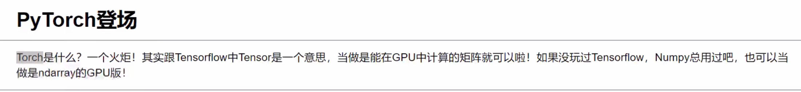

# 直播回放

## 开班第一课


## 神经网络


#  Python 基础

## 环境配置


## 库工具的安装


检查库


安装库


当安装库出错时，可以前去这个我网站，下载.whl 文件，然后在再命令行中安装


## NoteBook


打印当前路径

## Python 简介


## 数值计算


## 字符串操作


## 索引结构


/Snipaste2.10.2/history/temp/Snipaste_2026-09-27_15-06-07.png)


## 列表结构


 


## 字典结构


## 集合结构

 


## 赋值机制


重用

## 判断结构


## 循环结构


## 函数


## 模块与包


## 异常处理模块


	


## 文件操作


这样子简单写等价于上面的 try—fimally

## 类：面向对象


## 时间操作


# Python 进阶

## Anaconda 的使用

### 查看版本

```python
conda --version
# 简写
conda -V
```

### 查看虚拟环境

```python
conda env list
# 或
conda info --envs
```

### 创建虚拟环境


第二个命令补全了所有的基础包

```py
conda create -n gupao python=3.6
conda create -n gupao python=3.6 anacond
```

### 切换虚拟环境


```python
# Windows
conda activate myenv

# Linux/Mac（旧版conda）
source activate myenv
```

### 删除虚拟环境

```python
conda remove -n myenv --all
```

### 克隆虚拟环境

```python
conda create -n newenv --clone myenv
```

### 在 IDE 中添加虚拟环境


### 安装包

```python
# 安装包
conda install numpy

# 指定版本安装
conda install numpy=1.24

# 卸载包
conda remove numpy

# 查询当前环境已安装包
conda list

# 搜索包
conda search opencv
```


### 更新

```python
# 更新conda本身
conda update conda

# 更新anaconda整套
conda update anaconda

# 清理缓存（安装包缓存，释放空间）
conda clean -a
```

### 导入导出环境

```python
# 导出环境配置（yaml文件，跨平台推荐）
conda env export > environment.yml

# 根据yml文件创建环境
conda env create -f environment.yml

# Windows下导出简单包列表（不推荐跨系统）
conda list > requirements.txt
```

### 环境进阶操作

```python
# 重命名环境（conda 4.14+支持）
conda rename -n oldname newname

# 查看环境修改历史，可以回滚版本（非常好用，装包搞坏环境时）
conda list -n myenv --revisions

# 恢复环境到第3个历史版本
conda install -n myenv --revision 3

# 不激活环境，直接给指定环境安装包（-n 指定环境名）
conda install -n myenv opencv

# 不激活环境，查看指定环境已安装包
conda list -n myenv
```

### 包进阶操作

```python
# 更新当前环境所有包（谨慎使用，容易版本冲突）
conda update --all

# 从指定源安装包，-c 是channel
conda install -c conda-forge opencv

# 搜索包并查看详细信息
conda search pytorch --info

# 一次性安装多个包
conda install numpy scipy matplotlib

# 静默安装，自动确认y，不需要手动输入yes
conda install numpy --yes
```

## Jupyter


## Pytorch

### CPU 版本安装

直接在 conda 自己的虚拟环境中 pip install torch 和 pip install torchvision 即可

### GPU 版本安装


查看电脑 GPU 信息


验证安装的 CUDA  nvcc -V


检查是否安装成功

```
conda activate GPU
```

```
python
```

```
import torch
```

```
print(torch.cuda.is_available())
```

```
print(torch.cuda.get_device_name(0))
```

```
print(torch.__version__)
```

```
# 创建张量放到GPU上运算
x = torch.randn(10000,10000).cuda()
y = x @ x
print(y)
```


## 面向对象

见文件


## git 和 github

### 进入项目目录

```
cd ~/DeskTop/01file
```

### 初始化git仓库

```
git init
```


### 查看git状态

```
git status
```


### 提交至git仓库


```
git add 文件名
```


提交历史前需要进行下面的操作

```
git config --global user.name "Mark"
git config --global user.email "mark.tech.station@gmail.com"
```

```
git config --global --list   （查看是否配置成功）
```


```
git commit -m "说明性的文字"
```


### 查看commit提交历史

```
git log 
```


按q可以退出

### 回滚

三种不同的回滚场景


#### 改动只在工作区


可以看哪个地方被修改了

```
git diff
```

回滚工作区改动的文件

```
git restore 文件名
```


回滚多个文件，直接在后面添加文件名字即可


回滚当前目录的所有文件 


#### 改动已经在暂存区


将暂存区修改后的文件，回滚到工作区

```
git restore --staged .
```


之后便和改动只在工作区的一样了

#### 改动已经提交到历史


```
git reset --hard HEAD~1
```


#### 改动在历史区，但只需要回滚工作区，然后再提交，相当于新提交了一个


```
git revert HEAD
```


：wq  退出


### 忽略文件


note.txt 本来和项目无关 不需要提交 但是git每次会给他爆红很麻烦 如何忽视它呢


```
vim .gitignore
```


写入让git忽视的命令


### 分支


#### 创建分支


```
git branch 分支名字
```

#### 查看分支

```
git branch
```


*表示现在处于master分支

#### 切换分支


```
git switch 分支名
```


#### 创建并切换分支


```
git switch -c 分支名
```


#### 合并分支

合并分支要在主分支上去合并


```
git merge 分支名
```


合并完了之后，可以把分支删了、


```
git branch -d 分支名
```

#### 处理合并冲突

分支一


分支二


目前一个三个分支


合并第一个分支


合并第二个分支


出现了冲突

原因两个分支在同一个地方，加入了不同的代码，git不知道如何处理了


进入index.html文件

vim 文件名


### Rebase

要时常把自己的分支，挪到最新的master上去


实例


```
git rebase master
```


这里包冲突了

和合并分支一样用vim 文件名来解决冲突


继续挪移，不能提交


### Stash

现在正在开发一个功能，已经开发好了其中一个功能已经 commit了


但是开发的另一个功能才开发到一半，这时客服反馈在master上有个功能不行，需要修改，要返回到master上修改，但是切换不过去，发生错误了


```
git stash
```


修改一些bug的话，最后不要再master上改，需要创建一个新的分支，改完再合并


bug修复完成了，回到原来的分支上写还没有完成的功能


```
git stash pop
```

把存到stash里面的代码弹出来


/Snipaste2.10.2/history/temp/Snipaste_2026-10-11_21-25-11.png)


### Worktree


### github

#### git和github链接


#### 创建github仓库


假如有新的功能


#### 从github上下载代码


### 联合Vs Code

## Docker

### 下载镜像


 
### 查看镜像


### 删除镜像


### 拉取指定 CPU 架构版本的 nginx 镜像


### 使用镜像创建同时运行容器


/Snipaste2.10.2/history/temp/Snipaste_2026-10-12_18-17-24.png)

-d  让容器在后台运行


查看进程状况


### 挂载卷


### 删除容器


查看挂载卷的位置


### docker run的其他参数


### 更改容器名字


### 调试容器

#### 容器的启停


#### 查看容器的信息


#### 创建容器但不启动


#### 查看容器的日志


### 构建镜像


### Docker网络

#### 桥接模式


#### host模式


#### none模式


### Docker Compose


# 基础数学


## 高等数学

### 函数


### 极限


### 无穷大与无穷小


### 函数的连续性


### 导数


### 偏导数


### 方向导数


 

### 梯度


## 微积分

### 基础概念


### 定积分


## 泰勒公式与拉格朗日乘子法

### 泰勒公式


### 拉格朗日乘子法


## 线性代数基础


## 特征值与矩阵分解


## 随机变量


# 机器学习


# 深度学习基础与框架

## 简介





